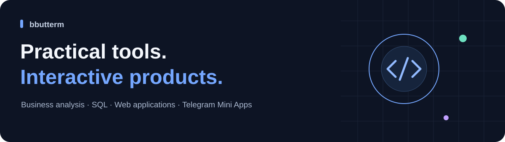
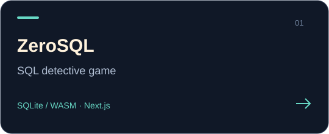
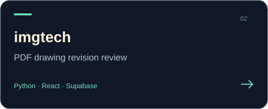
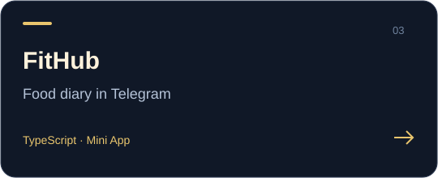
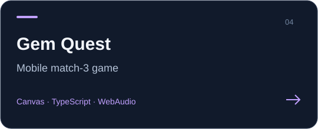
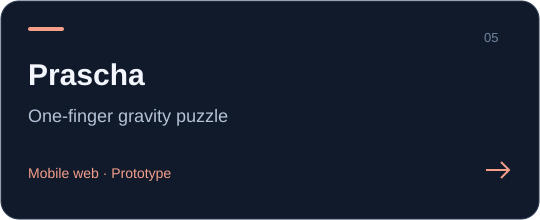
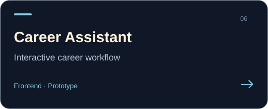

I'm a business analyst exploring how product requirements become useful tools and interactive experiences.

My projects span **SQL learning, document workflows, Telegram Mini Apps and browser games**. The selection below mixes applications and explicitly labelled prototypes; each repository documents its scope and current limitations.

## Selected work

<table>
<tr>
<td width="50%"> 
<a href="https://github.com/bbutterm/zerosql">Source &amp; project notes</a> · <a href="https://zerosql.vercel.app">Open demo</a></td>
<td width="50%"> 
<a href="https://github.com/bbutterm/imgtech">Source &amp; project notes</a> · <a href="https://imgtech.vercel.app">Open demo</a></td>
</tr>
<tr>
<td width="50%"> 
<a href="https://github.com/bbutterm/fithub">Source &amp; project notes</a> · <a href="https://fithub-virid.vercel.app">Open demo</a></td>
<td width="50%"> 
<a href="https://github.com/bbutterm/match3opus">Source &amp; project notes</a> · <a href="https://match3opus.vercel.app">Open demo</a></td>
</tr>
<tr>
<td width="50%"> 
<a href="https://github.com/bbutterm/cosmos">Source &amp; project notes</a> · <a href="https://cosmos-eosin-five.vercel.app">Open demo</a></td>
<td width="50%"> 
<a href="https://github.com/bbutterm/easyjob">Source &amp; project notes</a></td>
</tr>
</table>

**Where to start:** [ZeroSQL](https://zerosql.vercel.app) for interactive SQL, [imgtech](https://github.com/bbutterm/imgtech) for a document-review workflow, or [Gem Quest](https://match3opus.vercel.app) for a mobile game.

## Approach

- Start with the user scenario, requirements and constraints.
- Make workflows explicit: states, permissions and acceptance criteria.
- Keep project scope and prototype limitations visible.

**Technologies across these projects:** TypeScript, React, Next.js, Python, SQL, Supabase and Canvas.

Earlier engineering work

The archive includes C exercises and visual projects: [FdF](https://github.com/bbutterm/FdF), [push_swap](https://github.com/bbutterm/push_swap) and [Corewar_vis](https://github.com/bbutterm/Corewar_vis).

[Browse public repositories](https://github.com/bbutterm?tab=repositories)
