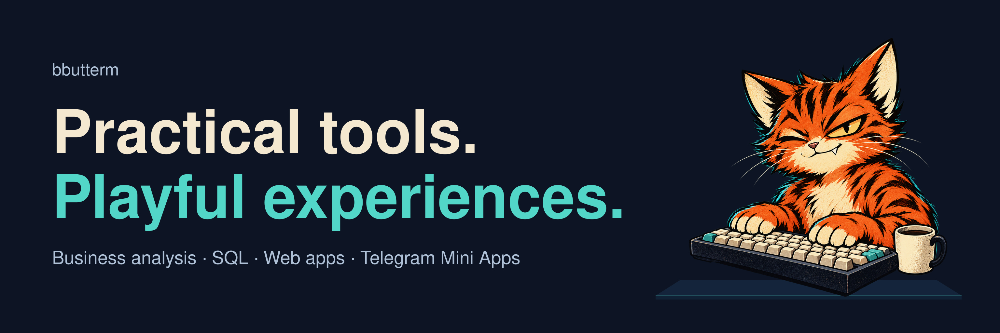

Hi, I'm <strong>bbutterm</strong> — a business analyst building useful tools and playful experiences.

I work on <strong>SQL learning, document workflows, Telegram Mini Apps and browser games</strong>. I like turning a user scenario into something you can actually try.

<h2>Selected work</h2>
<table>
<tr><td width="50%" valign="top"> <a href="https://github.com/bbutterm/zerosql">Source &amp; notes</a> · <a href="https://zerosql.vercel.app">Play demo</a></td>
<td width="50%" valign="top"> <a href="https://github.com/bbutterm/imgtech">Source &amp; notes</a> · <a href="https://imgtech.vercel.app">App · invitation required</a></td></tr>
<tr><td width="50%" valign="top"> <a href="https://github.com/bbutterm/fithub">Source &amp; notes</a> · Telegram access required</td>
<td width="50%" valign="top"> <a href="https://github.com/bbutterm/match3opus">Source &amp; notes</a> · <a href="https://match3opus.vercel.app">Play demo</a></td></tr>
<tr><td width="50%" valign="top"> <a href="https://github.com/bbutterm/cosmos">Source &amp; notes</a> · <a href="https://cosmos-eosin-five.vercel.app">Play demo</a></td>
<td width="50%" valign="top"> <a href="https://github.com/bbutterm/easyjob">Source &amp; notes</a> · Prototype</td></tr>
</table>

<h2>How I build</h2>

<strong>Start with the scenario.</strong> Make the workflow clear: states, permissions and acceptance criteria. Build a focused version, and document its scope and limitations.

Some projects solve practical problems; others explore how learning and games can make an interaction more engaging.

<strong>Across my projects:</strong> TypeScript · React · Next.js · Python · SQL · Supabase · Canvas

Earlier engineering work

C exercises and visual projects: <a href="https://github.com/bbutterm/FdF">FdF</a>, <a href="https://github.com/bbutterm/push_swap">push_swap</a> and <a href="https://github.com/bbutterm/Corewar_vis">Corewar_vis</a>.

<a href="https://github.com/bbutterm?tab=repositories">Browse all repositories →</a>

